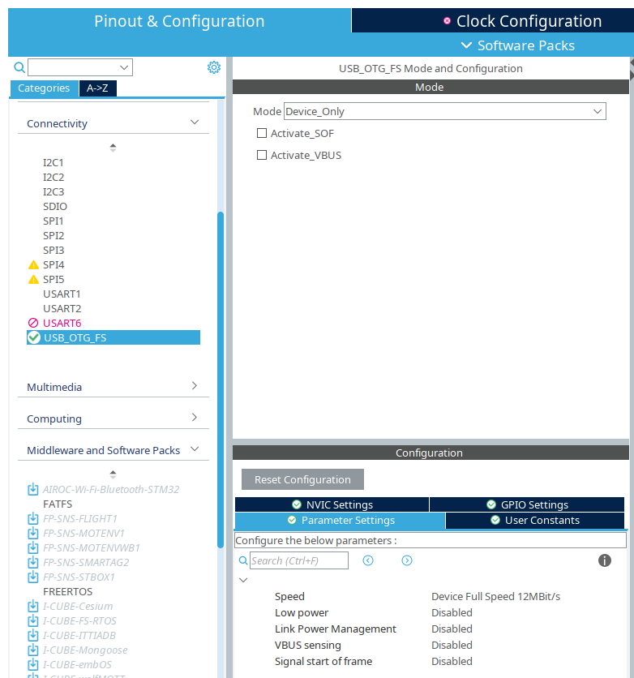
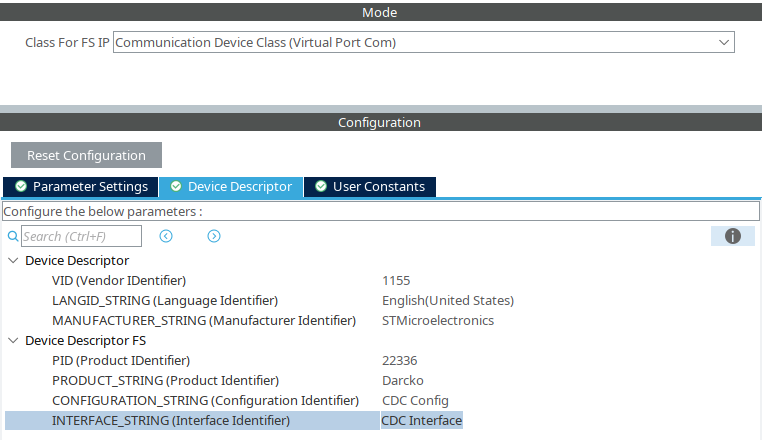
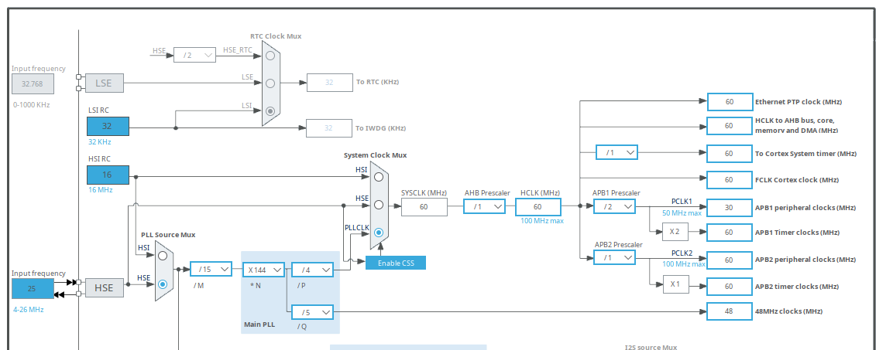
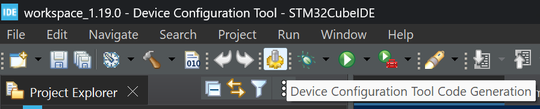

# USB-CDC (Communication Device Class) en STM32

[](https://opensource.org/licenses/MIT)
[](https://www.st.com/en/microcontrollers-microprocessors/stm32f4-series.html)
[](https://es.wikipedia.org/wiki/USB)

Este documento presenta una guía para implementar un **puerto serie virtual (VCP)** sobre USB en microcontroladores **STM32**, utilizando la clase **CDC** del middleware USB Device de **STM32CubeIDE**.
Incluye la configuración del periférico, la transmisión y recepción de datos, y un ejemplo combinado de eco por líneas con colores ANSI.

---

## Tabla de contenidos
- [USB-CDC (Communication Device Class) en STM32](#usb-cdc-communication-device-class-en-stm32)
  - [Tabla de contenidos](#tabla-de-contenidos)
  - [Descripción General](#descripción-general)
  - [Características Principales](#características-principales)
  - [Componentes Requeridos](#componentes-requeridos)
  - [Configuración del Proyecto en STM32CubeIDE](#configuración-del-proyecto-en-stm32cubeide)
    - [1. Crear un Nuevo Proyecto](#1-crear-un-nuevo-proyecto)
    - [2. Configurar el Periférico USB](#2-configurar-el-periférico-usb)
    - [3. Configurar el Reloj del Sistema](#3-configurar-el-reloj-del-sistema)
    - [4. Generar el Código](#4-generar-el-código)
  - [Implementación del Código](#implementación-del-código)
    - [Transmisión](#transmisión)
    - [Recepción](#recepción)
    - [Transmisión y Recepción (Eco por Líneas)](#transmisión-y-recepción-eco-por-líneas)
      - [¿Por qué acumular hasta el Enter?](#por-qué-acumular-hasta-el-enter)
      - [Recepción por líneas](#recepción-por-líneas)
      - [Transmisión del eco](#transmisión-del-eco)
      - [Limitaciones](#limitaciones)
  - [Prueba del Funcionamiento](#prueba-del-funcionamiento)
  - [Licencia](#licencia)

---

## Descripción General

La clase **CDC (Communication Device Class)** permite que un dispositivo USB se presente ante la computadora como un **puerto serie**. De esta forma, el microcontrolador puede comunicarse con cualquier terminal serie (PuTTY, minicom, la terminal serie de VS Code, etc.) utilizando únicamente el cable USB de la placa, sin necesidad de un convertidor TTL a USB como en el tutorial de [UART](/PerifericosBasicos/UART/README.md).

Actualmente se cubren los siguientes apartados:
- Transmisión de datos hacia la computadora.
- Recepción de datos desde la computadora.
- Eco por líneas con colores ANSI, combinando transmisión y recepción.

---

## Características Principales

- ✅ **USB 2.0 Full Speed (12 Mbit/s)**: utiliza el periférico `USB_OTG_FS` del microcontrolador.
- ✅ **Puerto serie virtual**: la computadora lo reconoce como un puerto COM o `/dev/ttyACMx`, sin hardware adicional.
- ✅ **Comunicación bidireccional**: transmisión y recepción de datos entre el microcontrolador y la computadora.
- ✅ **Multiplataforma**: funciona en Windows, Linux y macOS con los controladores incluidos en el sistema operativo.

>[!Note]
> A diferencia de UART, la velocidad (*baud rate*) seleccionada en la terminal **no afecta** a la comunicación: los datos viajan a la velocidad del bus USB. Puede seleccionarse cualquier valor en la terminal.

---

## Componentes Requeridos

- **STM32CubeIDE**: [Descargar desde STMicroelectronics](https://www.st.com/en/development-tools/stm32cubeide.html)
- **Placa de desarrollo**: STM32F411CEU6 (Black Pill) o compatible.
- **Programador/depurador**: ST-Link V2.
- **Cable USB tipo A a USB tipo C**: para conectar el puerto USB de la placa a la computadora.

---

## Configuración del Proyecto en STM32CubeIDE

### 1. Crear un Nuevo Proyecto

Siga los pasos del tutorial [Blink](/PerifericosBasicos/HelloWorld/README.md) para crear un nuevo proyecto para el `STM32F411CEU6`, incluyendo la configuración del reloj principal del sistema (HSE y PLL).

---

### 2. Configurar el Periférico USB

Acceda a `Pinout & Configuration` > `Connectivity` > `USB_OTG_FS` y, en `Mode`, seleccione la opción `Device_Only`. Esto habilita el periférico USB en modo dispositivo, permitiendo que el microcontrolador actúe como un dispositivo conectado a la computadora.

Adicionalmente se configurarán automáticamente los pines:
- `PA11`: USB_OTG_FS_DM
- `PA12`: USB_OTG_FS_DP



Posteriormente, en la sección `Middleware`, seleccione `USB_DEVICE` y en `Class For FS IP` elija `Communication Device Class (Virtual Port Com)`. Esto agrega al proyecto el middleware necesario para emular un puerto serie sobre USB.


En la pestaña `Device Descriptors` se configuran los parámetros con los que la computadora identifica al dispositivo: el identificador del fabricante (VID), el del producto (PID) y las cadenas descriptivas.

Ejemplo:

| Device Descriptor                   | Valor              |
|-------------------------------------|--------------------|
| Vendor ID (VID)                     | 1155 (`0x0483`)    |
| LANGID_STRING (Language identifier) | English            |
| MANUFACTURER_STRING                 | STMicroelectronics |

| Device Descriptor FS     | Valor            |
|--------------------------|------------------|
| PID (Product Identifier) | 22336 (`0x5740`) |
| PRODUCT_STRING           | Darcko           |
| CONFIGURATION_STRING     | CDC Config       |
| INTERFACE_STRING         | CDC Interface    |



>[!Note]
> Los valores VID `0x0483` y PID `0x5740` son los que STMicroelectronics asigna a su puerto COM virtual y se pueden usar libremente para desarrollo. Para un producto comercial es necesario contar con un VID propio.

---

### 3. Configurar el Reloj del Sistema

El periférico USB requiere un reloj de **exactamente 48 MHz**. Este reloj se obtiene de la salida `Q` del PLL y se muestra en la pestaña `Clock Configuration` como `48MHz Clocks`. Si el valor es incorrecto, STM32CubeIDE lo marcará en rojo.

Para la Black Pill (cristal HSE de 25 MHz) se utilizó la siguiente configuración:

| Parámetro          | Valor   |
|--------------------|---------|
| HSE                | 25 MHz  |
| PLLM (`/M`)        | 15      |
| PLLN (`*N`)        | 144     |
| PLLP (`/P`)        | 4       |
| PLLQ (`/Q`)        | 5       |
| SYSCLK / HCLK      | 60 MHz  |
| 48MHz Clocks (USB) | 48 MHz  |



>[!Tip]
> El reloj del sistema puede ser distinto de 60 MHz, siempre que la salida `Q` del PLL siga entregando 48 MHz. Por ejemplo, con `PLLM = 25`, `PLLN = 192`, `PLLP = 2` y `PLLQ = 4` se obtienen 96 MHz de SYSCLK y 48 MHz para el USB.

---

### 4. Generar el Código

Una vez realizada toda la configuración, haga clic en el icono de la **llave amarilla** para generar el código base del proyecto.



---

## Implementación del Código

### Transmisión

El archivo `USB_DEVICE/App/usbd_cdc_if.h` declara las funciones de la interfaz CDC. Para utilizarlas desde `main.c` es necesario incluirlo:

```c
/* Includes ------------------------------------------------------------------*/
#include "main.h"
#include "usb_device.h"

/* Private includes ----------------------------------------------------------*/
/* USER CODE BEGIN Includes */
#include "usbd_cdc_if.h"
/* USER CODE END Includes */
```

Para enviar datos hacia la computadora se utiliza la función `CDC_Transmit_FS()`, que recibe un puntero a los datos y la cantidad de bytes a enviar:

```c
uint8_t CDC_Transmit_FS(uint8_t* Buf, uint16_t Len)
```

La función devuelve:
- `USBD_OK`: la transmisión se inició correctamente.
- `USBD_BUSY`: aún hay una transmisión anterior en curso; los datos **no** se envían.
- `USBD_FAIL`: el dispositivo todavía no ha sido configurado por la computadora.

Ejemplo de envío de una cadena cada segundo en `main.c`:

```c
/* Private includes ----------------------------------------------------------*/
/* USER CODE BEGIN Includes */
#include <string.h>
#include "usbd_cdc_if.h"
/* USER CODE END Includes */

/* USER CODE BEGIN PV */
char *data = "Hola Mundo desde STM32 USB\r\n";
/* USER CODE END PV */

/**
  * @brief  The application entry point.
  * @retval int
  */
int main(void)
{
  /* USER CODE BEGIN WHILE */
  while (1)
  {
	  CDC_Transmit_FS((uint8_t *)data, strlen(data));
	  HAL_Delay(1000);
    /* USER CODE END WHILE */

    /* USER CODE BEGIN 3 */
  }
  /* USER CODE END 3 */
}
```

>[!Note]
> `CDC_Transmit_FS()` no es bloqueante: solo inicia la transferencia y regresa de inmediato. Por ello, el buffer enviado no debe modificarse hasta que la transferencia termine. Además, los mensajes enviados antes de que la computadora termine de reconocer el dispositivo se pierden.

---

### Recepción

La función `CDC_Receive_FS()`, ubicada en `USB_DEVICE/App/usbd_cdc_if.c`, es llamada automáticamente cada vez que llega un paquete desde la computadora. Recibe un puntero a los datos (`Buf`) y la cantidad de bytes recibidos (`Len`).

>[!Important]
> `CDC_Receive_FS()` se ejecuta dentro de la interrupción del USB. Debe mantenerse breve: no utilice `HAL_Delay()` ni `CDC_Transmit_FS()` dentro de ella. Lo recomendable es copiar los datos y procesarlos en el ciclo principal.

Para copiar los datos recibidos a un buffer propio se utiliza la función `memcpy()`. Al terminar, la recepción se rearma con `USBD_CDC_SetRxBuffer()` y `USBD_CDC_ReceivePacket()` para poder recibir el siguiente paquete.

**main.c**
```c
/* USER CODE BEGIN PV */
uint8_t buffer[64];
/* USER CODE END PV */
```

**usbd_cdc_if.c**
```c
/* USER CODE BEGIN PV */
/* Private variables ---------------------------------------------------------*/
extern uint8_t buffer[64];
/* USER CODE END PV */

static int8_t CDC_Receive_FS(uint8_t* Buf, uint32_t *Len)
{
  /* USER CODE BEGIN 6 */
  memcpy(buffer, Buf, *Len);

  USBD_CDC_SetRxBuffer(&hUsbDeviceFS, &Buf[0]);
  USBD_CDC_ReceivePacket(&hUsbDeviceFS);
  return (USBD_OK);
  /* USER CODE END 6 */
}
```

Esto funciona correctamente; sin embargo, si primero se recibe una cadena larga y posteriormente una más corta, la cadena corta sobrescribe solo el inicio del buffer y los **caracteres restantes de la cadena anterior permanecen al final**. Por ejemplo, al recibir `Hola Mundo` y luego `Adios`, el buffer contendrá `AdiosMundo`.

Para evitarlo, se limpia el buffer antes de copiar los nuevos datos y se limita la copia a 63 bytes, de modo que siempre quede espacio para el carácter nulo `'\0'` que termina la cadena:

```c
static int8_t CDC_Receive_FS(uint8_t* Buf, uint32_t *Len)
{
  /* USER CODE BEGIN 6 */
  uint32_t len = (*Len < sizeof(buffer)) ? *Len : sizeof(buffer) - 1;
  memset(buffer, '\0', sizeof(buffer));
  memcpy(buffer, Buf, len);

  USBD_CDC_SetRxBuffer(&hUsbDeviceFS, &Buf[0]);
  USBD_CDC_ReceivePacket(&hUsbDeviceFS);
  return (USBD_OK);
  /* USER CODE END 6 */
}
```

---

### Transmisión y Recepción (Eco por Líneas)

En este ejemplo se combinan la transmisión y la recepción: el microcontrolador envía periódicamente un mensaje y, además, devuelve a la computadora (eco) cada cadena que recibe, pero en **otro color**. La cadena se envía **completa al presionar la tecla Enter**, no carácter por carácter.

Para los colores se utilizan los códigos de escape ANSI de la librería [ANSII_Codes](/Librerias/ANSII_Codes/README.md). Es necesario agregar su ruta (`Librerias/ANSII_Codes/`) a los *include paths* del proyecto (`Project` > `Properties` > `C/C++ Build` > `Settings` > `MCU GCC Compiler` > `Include paths`) y utilizar una terminal que soporte colores ANSI.

#### ¿Por qué acumular hasta el Enter?

La mayoría de las terminales envían cada tecla en cuanto se presiona, por lo que `CDC_Receive_FS()` se llama una vez por carácter. Si se reenvía directamente lo recibido, el eco llega letra por letra. Para enviar la cadena completa, los caracteres se guardan en un buffer hasta recibir `'\r'` o `'\n'` (Enter); en ese momento la línea se cierra con `'\0'` y se avisa a `main.c` mediante una bandera.

#### Recepción por líneas

**usbd_cdc_if.c**
```c
/* USER CODE BEGIN PV */
/* Private variables ---------------------------------------------------------*/
extern uint8_t bufferReceiver[64];
extern volatile uint8_t lineReady;
static uint8_t lineLen = 0;
/* USER CODE END PV */

static int8_t CDC_Receive_FS(uint8_t* Buf, uint32_t *Len)
{
  /* USER CODE BEGIN 6 */
  // Acumula caracteres hasta Enter ('\r' o '\n'); main.c envía la línea completa
  for (uint32_t i = 0; i < *Len; i++)
  {
    uint8_t c = Buf[i];
    if (c == '\r' || c == '\n')
    {
      // lineLen > 0 ignora el '\n' de un "\r\n" (línea vacía)
      if (lineLen > 0 && !lineReady)
      {
        bufferReceiver[lineLen] = '\0';
        lineLen = 0;
        lineReady = 1;
      }
    }
    else if (!lineReady && lineLen < sizeof(bufferReceiver) - 1)
    {
      bufferReceiver[lineLen++] = c;
    }
  }

  // Rearmar la recepción después de procesar Buf
  USBD_CDC_SetRxBuffer(&hUsbDeviceFS, &Buf[0]);
  USBD_CDC_ReceivePacket(&hUsbDeviceFS);
  return (USBD_OK);
  /* USER CODE END 6 */
}
```

Puntos importantes:
- `lineReady` se declara `volatile` porque se modifica dentro de la interrupción USB y se lee en el ciclo principal.
- Si la terminal envía `\r\n`, el segundo carácter generaría una línea vacía; la condición `lineLen > 0` la descarta.
- Mientras `lineReady` vale `1`, no se escribe en `bufferReceiver`, para no modificar la línea que `main.c` todavía no ha enviado.
- Ya no es necesario limpiar el buffer con `memset()`, ya que cada línea termina con su propio `'\0'`.

#### Transmisión del eco

**main.c**
```c
/* USER CODE BEGIN Includes */
#include <string.h>
#include <stdio.h>
#include "usbd_cdc_if.h"
#include "ANSII_Codes.h"
/* USER CODE END Includes */

/* USER CODE BEGIN PV */
char bufferTransmiter[128]; // 64 bytes de datos + códigos de color + "\r\n"
uint8_t bufferReceiver[64];
volatile uint8_t lineReady = 0; // 1 cuando CDC_Receive_FS recibió una línea completa (Enter)
/* USER CODE END PV */

int main(void)
{
  /* USER CODE BEGIN 1 */
  uint32_t lastTick = 0;
  /* USER CODE END 1 */

  /* ... inicialización generada por STM32CubeIDE ... */

  /* USER CODE BEGIN WHILE */
  while (1)
  {
	  // Eco de la línea completa en otro color (CDC_Receive_FS la arma hasta el Enter)
	  if (lineReady)
	  {
		  snprintf(bufferTransmiter, sizeof(bufferTransmiter), "%sRecibido: %s%s\r\n",
				   COLOR_BRIGHT_YELLOW, (char *)bufferReceiver, COLOR_RESET);
		  lineReady = 0; // libera bufferReceiver para la siguiente línea
		  CDC_Transmit_FS((uint8_t *)bufferTransmiter, strlen(bufferTransmiter));
	  }

	  // Sin HAL_Delay: así el eco no espera hasta 1 s
	  if (HAL_GetTick() - lastTick >= 1000)
	  {
		  lastTick = HAL_GetTick();
		  snprintf(bufferTransmiter, sizeof(bufferTransmiter), "%sHola Mundo desde STM32 USB%s\r\n",
				   COLOR_BRIGHT_CYAN, COLOR_RESET);
		  CDC_Transmit_FS((uint8_t *)bufferTransmiter, strlen(bufferTransmiter));
		  HAL_GPIO_TogglePin(GPIOC, GPIO_PIN_13);
	  }
    /* USER CODE END WHILE */

    /* USER CODE BEGIN 3 */
  }
  /* USER CODE END 3 */
}
```

Puntos importantes:
- El mensaje periódico se envía en cian (`COLOR_BRIGHT_CYAN`) y el eco en amarillo (`COLOR_BRIGHT_YELLOW`); se puede usar cualquier color definido en `ANSII_Codes.h`. `COLOR_RESET` regresa la terminal a su color normal.
- `bufferTransmiter` es de 128 bytes porque debe contener hasta 63 caracteres recibidos, más el texto `Recibido: `, los códigos de color y `\r\n`. Se usa `snprintf()` para nunca escribir fuera del buffer.
- Se reemplazó `HAL_Delay(1000)` por una comparación con `HAL_GetTick()`. Con `HAL_Delay()` el ciclo quedaría bloqueado y el eco podría tardar hasta 1 segundo en enviarse.
- El LED de la placa (`PC13`) cambia de estado con cada mensaje periódico, lo que permite verificar visualmente que el programa está en ejecución. El pin debe estar configurado como `GPIO_Output`, como en el tutorial [Blink](/PerifericosBasicos/HelloWorld/README.md).

#### Limitaciones

- Cada línea admite como máximo **63 caracteres**; los caracteres adicionales se descartan.
- Si llega una nueva línea antes de que `main.c` haya enviado la anterior, lo recibido en ese intervalo se descarta.
- Si el eco y el mensaje periódico coinciden, `CDC_Transmit_FS()` puede devolver `USBD_BUSY` y el segundo mensaje no se envía.
- Ambos mensajes comparten `bufferTransmiter`. Como `CDC_Transmit_FS()` no copia los datos, escribir el segundo mensaje mientras el primero aún se transmite podría alterarlo. Para mayor robustez, se recomienda usar un buffer independiente para cada mensaje.

Para líneas más largas o datos a mayor velocidad, se recomienda implementar un buffer circular.

---

## Prueba del Funcionamiento

1. Programe la placa con el ST-Link.
2. Conecte el puerto USB-C de la Black Pill a la computadora.
3. Identifique el puerto serie virtual:
   - **Windows 10/11**: aparece en el *Administrador de dispositivos* como `Dispositivo serie USB (COMx)`. En versiones anteriores es necesario instalar el controlador [STSW-STM32102](https://www.st.com/en/development-tools/stsw-stm32102.html).
   - **Linux**: aparece como `/dev/ttyACM0` (puede verificarse con `lsusb`, que mostrará el dispositivo `0483:5740`).
   - **macOS**: aparece como `/dev/tty.usbmodemXXXX`.
4. Abra el puerto con cualquier terminal serie. Por ejemplo, en Linux:

```bash
picocom /dev/ttyACM0
```

>[!Tip]
> En Linux, si aparece un error de permisos al abrir el puerto, agregue su usuario al grupo `dialout` con `sudo usermod -aG dialout $USER` y vuelva a iniciar sesión.

Al escribir un texto y presionar Enter, la terminal mostrará el eco en amarillo, intercalado con el mensaje periódico en cian.

---

## Licencia

Este proyecto se distribuye bajo la licencia MIT. Consulte el archivo [LICENSE](/LICENSE.md) para más detalles.
