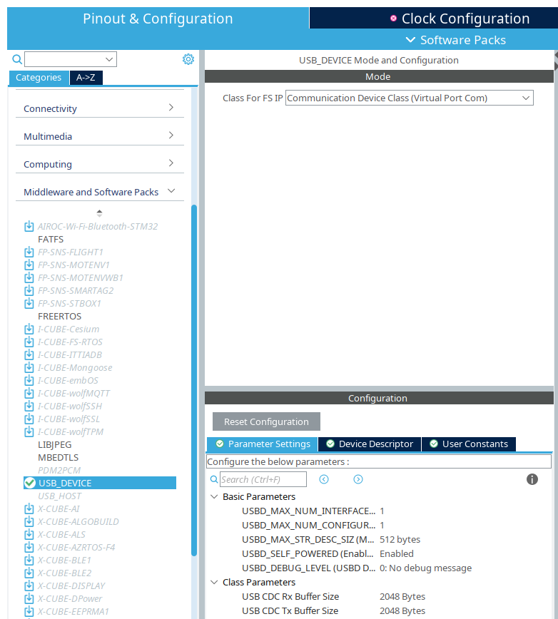

# USB-CDC (Communication Device Class)

## Tabla de contenidos
- [USB-CDC (Communication Device Class)](#usb-cdc-communication-device-class)
  - [Tabla de contenidos](#tabla-de-contenidos)
- [Descripción](#descripción)
  - [Caracerísticas Principales](#caracerísticas-principales)
  - [Componentes Requeridos](#componentes-requeridos)
  - [Configuración del Proyecto en STM32CubeIDE](#configuración-del-proyecto-en-stm32cubeide)
    - [1. Crear un Nuevo Proyecto](#1-crear-un-nuevo-proyecto)
    - [2. Configurar el Periférico USB](#2-configurar-el-periférico-usb)
    - [3. Configurar el Reloj del Sistema](#3-configurar-el-reloj-del-sistema)
    - [4. Generar el Código](#4-generar-el-código)

---

# Descripción

Este proyecto implementa la funcionalidad de un dispositivo USB que utiliza la clase de comunicación (CDC) para permitir la comunicación entre un microcontrolador STM32 y una computadora a través de un puerto USB. La clase CDC es ampliamente utilizada para emular puertos serie sobre USB, lo que permite la transmisión de datos de manera eficiente y confiable.

---

## Caracerísticas Principales
- **Compatibilidad con USB 2.0**: El proyecto es compatible con la especificación USB 2.0, lo que garantiza una comunicación rápida y estable.
- **Emulación de Puerto Serie**: Permite que el microcontrolador STM32 se comporte como un puerto serie virtual, facilitando la comunicación con aplicaciones de terminal en la computadora.
- **Transferencia de Datos Bidireccional**: Soporta la transmisión y recepción de datos entre el microcontrolador y la computadora, permitiendo una comunicación bidireccional eficiente.
- **Configuración Flexible**: Permite configurar parámetros como la velocidad de transmisión, el tamaño del buffer y otros aspectos de la comunicación para adaptarse a diferentes necesidades de la aplicación.
- **Compatibilidad con Diferentes Sistemas Operativos**: Funciona en múltiples sistemas operativos, incluyendo Windows, Linux y macOS, lo que facilita su integración en diversos entornos de desarrollo.

## Componentes Requeridos
- **STM32CubeIDE** – [Descargar desde STMicroelectronics](https://www.st.com/en/development-tools/stm32cubeide.html)  
- **Placa de desarrollo**: STM32F411CEU6 (Black Pill) o compatible.  
- **Programador/depurador**: ST-Link V2.  
- **Cables**: Cable USB tipo A a USB tipo C para la conexión entre la placa y la computadora.

---

## Configuración del Proyecto en STM32CubeIDE

### 1. Crear un Nuevo Proyecto

Siga los pasos del tutorial [Blink](/PerifericosBasicos/HelloWorld/README.md) para crear un nuevo proyecto destinado al microcontrolador `STM32F411CEU6`, incluyendo la configuración del reloj principal del sistema (HSE y PLL).

---

### 2. Configurar el Periférico USB

Para la configuración del periférico USB, acceda a: `Pinout & Configuration` > `Connectivity` > `USB_OTG_FS` y seleccione la opción `Device_Only`. Esto habilitará el periférico USB en modo dispositivo, permitiendo que el microcontrolador actúe como un dispositivo USB conectado a una computadora.

Posteriormente en la pestaña `Middleware`, habilite la opción `USB_DEVICE` y seleccione la clase `Communication Device Class (CDC)`. Esto configurará el proyecto para utilizar la clase CDC, permitiendo la emulación de un puerto serie sobre USB.

Seleccionar la pestaña `Device Descriptors` y configurar los parámetros del dispositivo USB, como el nombre del fabricante, el nombre del producto y el número de serie. Esto es importante para que la computadora pueda identificar correctamente el dispositivo USB conectado.

Ejemplo:
| Device Descriptor | Value |
|-------------------|-------|
| Vendor ID (VID) | 1155 |
| LANGID_STRING (Language identifier) | English |
| Manufacturer_string | STMicroelectronics |

| Device Descriptor FS | Value |
|-------------------|-------|
| PID (Product Identifier) | 22336 |
| Product_string | Darcko |
| CONFIGURATION_STRING | CDC Config |
| Interface_string | CDC Interface |

### 3. Configurar el Reloj del Sistema

La configuración del reloj debe de mantenerse en 48 MHz para el periférico USB, ya que esta es la frecuencia requerida para la operación correcta del USB. Asegúrese de que el reloj del sistema esté configurado adecuadamente para cumplir con este requisito.

### 4. Generar el Código

Una vez realizada toda la configuración, haga clic en el ícono de la **llave amarilla** para generar el código base del proyecto.

